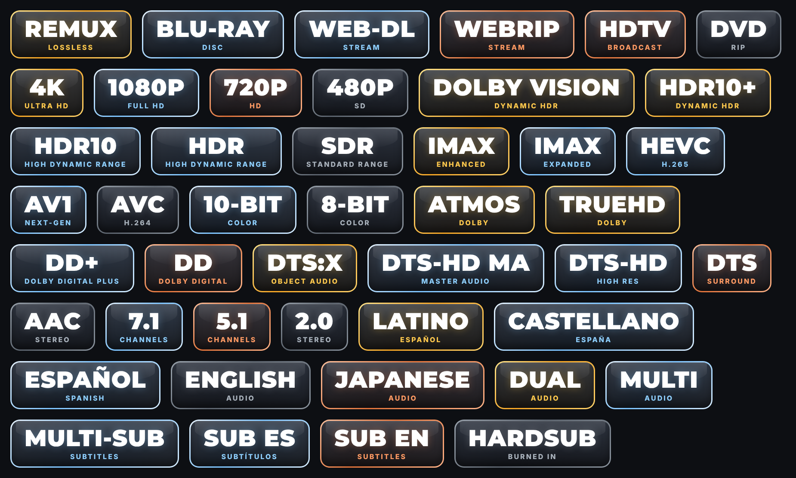

# Nuvio Badges

Two original sets of 45 stream badges for Nuvio: **Metal** and **Glass**. Same badges and matching rules, different look. Install one.

Each set covers source, resolution, HDR, codec, bit depth, audio format, channels, plus audio language and subtitles (Latino, Castellano, Español, English, Japanese, Dual Audio, Multi Audio, Multi-Sub, Spanish/English subs, Hardsub).

Tiers: gold marks the top (4K, REMUX, Dolby Vision, Atmos, TrueHD, DTS:X, Latino, Dual Audio), then silver, bronze and steel for the basics.

## Metal

```
https://raw.githubusercontent.com/parchito/nuvio-badges/main/metal.json
```


## Glass

```
https://raw.githubusercontent.com/parchito/nuvio-badges/main/glass.json
```



## Use it

Paste one URL where Nuvio asks for a badge pack, then restart the app.

Badge names describe audio, video and language formats only. All trademarks belong to their owners; no logos are used.
